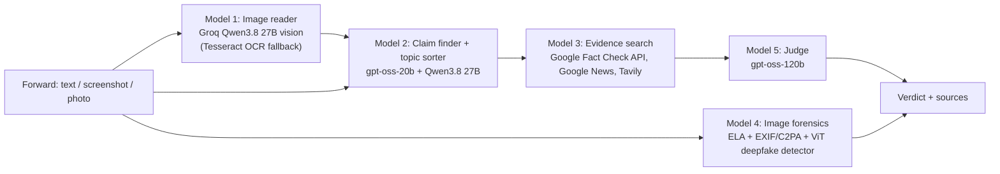

# SachCheck: WhatsApp forward fact-checker

**A multi-model AI fact-checker that reads WhatsApp forwards (text or images), checks the claims against trusted sources, and flags edited or AI-generated images, so people can stop fake health, political and financial news before it spreads.**

> Live demo: _add your Vercel link here_

Fake forwards (miracle cures, "RBI is banning ₹10 coins", edited photos) spread fast in Indian family and community groups. Most people can't easily check them, and fact-checks from PIB, Alt News or BOOM rarely reach the same group. SachCheck lets anyone paste a forward, upload a screenshot, or share it straight from WhatsApp, and get a plain-English verdict with sources in about 10–20 seconds.

---

## How it works: five models, one verdict



| # | Model | Tool (all free) | Job |
|---|---|---|---|
| 1 | Image reader | Groq `qwen3.8-27b` (reads images); **Tesseract.js** (English, Hindi, Telugu) runs in the browser when there's no key | Reads the text inside screenshots |
| 2a | Claim finder | Groq `gpt-oss-20b` | Picks out the checkable claims and writes an English search query for each |
| 2b | Topic sorter | Groq `qwen3.8-27b` | Labels each claim: health, political, financial or other |
| 3 | Evidence search | Google Fact Check Tools API, Google News RSS, Tavily | Finds fact-checks (PIB, Alt News, BOOM, Factly, Vishvas News…) and trusted news; ranks fact-checks first |
| 4 | Image forensics | Error Level Analysis (pure JS), EXIF/XMP/C2PA markers, `prithivMLmods/AI-vs-Deepfake-vs-Real` ViT model in the browser (transformers.js) | Edited areas, editing software, AI-generation markers, deepfake probability |
| 5 | Judge | Groq `gpt-oss-120b` | Weighs **only the evidence found** and answers True / False / Misleading / Unverified, citing sources |

**Works with no keys.** Every AI step has a rule-based fallback (sentence rules, keyword classifier, rating rules) and Google News needs no key, so the app always runs in a "basic mode". Keys make it much better.

**WhatsApp without the paid API.** The site is an installable web app (PWA) with a **Web Share Target**: on Android, install it once, then use WhatsApp's **Share** button on any forward and pick SachCheck. An optional **Telegram bot** uses the same pipeline. In production this could plug into the WhatsApp Business API; the prototype uses the PWA + Telegram to stay free.

---

## Test results

All test data is generated or written by scripts in this repo; nothing is downloaded. Full numbers are on the site's **Test results** page.

| Test | What | Result |
|---|---|---|
| Fact-check verdicts, basic mode (no keys) | 50 known claims (30 fake/misleading, 20 true) in English, Hindi and Telugu: `data/claims.json` | Caught **12 of 30** fakes, **never called a fake claim true**, wrongly flagged 1 of 20 true claims; says "Unverified" when it can't settle a claim |
| Fact-check verdicts, AI mode | Same 50 claims with Groq + Fact Check API + Tavily | **48 of 50 right (96%)**: caught **all 30** fakes, confirmed 18 of 20 true claims (2 left "Unverified"), **0** fakes called true, **0** true claims called fake; topic sorting 94% right |
| Reading text from images | 6 generated WhatsApp screenshots | Tesseract: **100%**; Groq Qwen vision: **92%** (perfect on English and Hindi, 54% on Telugu). Clean generated images, so real phone screenshots score lower |
| Spotting edited photos (ELA) | 60 unseen generated photos with a pasted-in patch vs untouched | **67%** on fresh edits, **60%** after WhatsApp-style re-compression (50% = guessing) |

**Honest limits**

- Image forensics are *signals, not proof*. When WhatsApp re-compresses an image it wipes out most editing traces, as test 3 shows. Free AI-image detectors are often wrong on compressed images.
- Very new claims may have no fact-check or news coverage yet, so the answer is "Unverified". That is deliberate: the judge is told never to guess from general knowledge.
- The basic mode is cautious: it can debunk using fact-checker headlines, but it never confirms a claim as true.

---

## Run it locally

Requires Node 20+ (and Python 3 with Pillow only if you want to regenerate the sample images).

```bash
npm install
cp .env.example .env.local   # add any keys you have (all optional)
npm run dev                  # http://localhost:3000
```

| Command | What it does |
|---|---|
| `npm test` | 96 unit tests (Vitest) |
| `npm run coverage` | Tests with coverage (~95% of `src/lib`) |
| `npm run samples` | Regenerates screenshots, test photos and icons (`scripts/make_samples.py`) |
| `npm run eval:claims` | Runs the 50 claims through the pipeline → `public/data/eval-claims-<mode>.json` |
| `npm run eval:ocr` | OCR accuracy → `public/data/eval-ocr.json` |
| `npm run eval:forensics` | Edited-photo detection, tuned on one set and tested on another → `public/data/eval-forensics.json` |
| `npm run telegram:webhook -- https://your-app.vercel.app` | Connects the Telegram bot after deploying |

### Environment variables (all optional, all free)

| Variable | Where to get it | Used by |
|---|---|---|
| `GROQ_API_KEY` | [console.groq.com/keys](https://console.groq.com/keys) | Models 1, 2 and 5 |
| `GOOGLE_FACTCHECK_API_KEY` | Google Cloud → enable "Fact Check Tools API" → Credentials → API key | Model 3 |
| `TAVILY_API_KEY` | [app.tavily.com](https://app.tavily.com) | Model 3 |
| `TELEGRAM_BOT_TOKEN`, `TELEGRAM_WEBHOOK_SECRET` | @BotFather on Telegram; the secret is any random string | Telegram bot |

See [SETUP.md](SETUP.md) for step-by-step instructions.

---

## Project structure

```
src/
  app/                    pages (/, /results) and API routes
    api/check             text pipeline: extract → classify → search → judge
    api/ocr               Groq vision OCR (503 without key → browser Tesseract)
    api/telegram          Telegram webhook
    api/status            which services are switched on
    manifest.ts           installable app + share target
  components/             Checker, PipelineSteps, VerdictCard, ImageReport, …
  hooks/useChecker.ts     runs the whole flow in the browser
  lib/
    claims.ts classify.ts verdict.ts pipeline.ts   models 2 and 5 (+ rule-based fallbacks)
    evidence/             model 3: Fact Check API, Google News RSS, Tavily, ranking
    forensics/            model 4: ELA, metadata, combined suspicion score
    client/               browser-only: Tesseract OCR, deepfake detector, share target
public/sw.js              service worker that receives shared items
data/                     50 labelled claims, OCR truth, generated forensics photos
scripts/                  sample generator and evaluation scripts
```

## Tech

Next.js 16 (App Router) · React 19 · TypeScript · Tailwind CSS 4 · Zod · Vitest · jpeg-js · exifr · tesseract.js · transformers.js · Groq API. Hosted free on Vercel.

_Student project. AI can be wrong: always open the sources before you forward anything._
